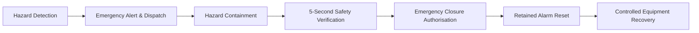

# SENTINEL
### Intelligent Emergency Detection & Response System

SENTINEL is an interactive, browser-based industrial emergency-management and command-and-control simulation. It demonstrates modern multi-zone hazard detection, autonomous protective countermeasures, response-team dispatching, certified safety verification, and operator-controlled equipment restoration within a simulated high-consequence research and processing facility.

> [!IMPORTANT]
> **Simulation & Educational Disclaimer**<br>
> SENTINEL is an educational and demonstration-oriented simulation. All telemetry readings, emergency scenarios, dispatch operations, sensor states, and automated protective responses are generated deterministically in software. It is not certified, designed, or intended to monitor or control real industrial machinery, high-voltage equipment, hazardous chemicals, or certified physical life-safety installations.

---

## Table of Contents

- [Project Overview](#project-overview)
- [Industrial Facility Zones](#industrial-facility-zones)
- [Emergency Response Workflow](#emergency-response-workflow)
- [Core Features](#core-features)
- [System Architecture](#system-architecture)
- [Technology Stack](#technology-stack)
- [Installation & Local Development](#installation--local-development)
- [Interface & Visual Walkthrough](#interface--visual-walkthrough)
- [Deployment Guide](#deployment-guide)
- [Automated Testing & Quality Assurance](#automated-testing--quality-assurance)
- [Project Status](#project-status)

---

## Project Overview

Modern industrial operations demand robust emergency protocols where automated protective machinery, on-site intervention teams, and human operators collaborate seamlessly. SENTINEL models this high-stress environment inside a responsive, dark industrial interface featuring:

- **Interactive 3D Digital Twin:** Real-time spatial facility view rendered in WebGL with isometric camera projection and dynamic zone health beacons.
- **Four Monitored Operational Zones:** Independent environments with distinct hazard physics, telemetry sensors, and automated protection equipment.
- **Closed-Loop Hazard Simulation:** Central deterministic scheduler that simulates thermal runaways, toxic gas releases, security intrusions, and station alarms.
- **Deterministic Response Dispatch:** Timed turnout, en-route vehicle transit, and on-site tactical operations for specialized emergency squads.
- **Authoritative Operator Workflows:** Guided navigation directing operators through alarm acknowledgement, trip clearance, physical safety inspections, formal incident closure, alarm resetting, and controlled equipment recovery.

---

## Industrial Facility Zones

The simulated complex is partitioned into four monitored operational zones, each governed by specialized sensor telemetry and dedicated protective countermeasures:

| Zone Identifier | Zone Name | Primary Hazard Model | Dedicated Sensors | Automated Countermeasures | Dispatched Response Unit |
| :--- | :--- | :--- | :--- | :--- | :--- |
| **ZN-01** | **Research Laboratory** | Thermal Runaway & Fire | Optical Smoke Density, High-Temp Thermal Sensor (Threshold: 60°C) | Automated High-Pressure Deluge Foam Mist, Emergency Ventilation Dampers | Internal Fire Brigade (Turnout: 30s) |
| **ZN-02** | **Chemical Laboratory** | Toxic Reagent Gas Leak | Gas Concentration Sensor (0–255 Scale, Threshold: 40) | 3-Second Fast Fail-Secure Isolation Valve, Emergency Extraction Scrubbers | Specialized HazMat Squad (Turnout: 30s) |
| **ZN-03** | **Restricted Storage** | Perimeter Breach & Intrusion | Laser Optical Tripwire, Vault Volumetric Radar | Fail-Secure Magnetic Vault Lockdown (Emergency Egress Preserved) | Tactical Security Unit (Turnout: 30s) |
| **ZN-04** | **Control Room** | Manual Emergency Trip | Physical Station Trip Switch, Panel Alarm Latches | System-Wide Alerting, Retained Audible Alarm Latches, Operations Panel Lockout | Facility Safety Officer & Response Command |

---

## Emergency Response Workflow

Every industrial incident in SENTINEL progresses through an authoritative, state-enforced emergency lifecycle. Operators cannot skip phases or bypass safety interlocks:



1. **Hazard Detection & Early Warning:** Telemetry sensors evaluate real-time environmental metrics against configured thresholds. Anomalies trigger early warnings, while dual-confirmation conditions (e.g., simultaneous optical smoke and temperature $\ge 60^\circ\text{C}$) declare confirmed emergencies.
2. **Autonomous Protective Response & Dispatch:** Automated protective systems activate immediately without waiting for human intervention. Specialized emergency response teams enter autonomous turnout and dispatch progression.
3. **Operator Acknowledgement:** The operator acknowledges the alarm in the incident console. This records operator ownership and silences audible sirens without interfering with active suppression or team transit.
4. **Hazard Mitigation & Containment:** Protective countermeasures mitigate hazard intensity (cooling temperatures, venting smoke, extracting gas, or neutralizing intrusions) until the environment reaches nominal containment parameters.
5. **Certified Safety Verification:** The operator initiates a physical safety inspection. The central simulation scheduler executes a mandatory five-second physical verification sweep against live sensor telemetry. Verification passes only if environmental conditions remain nominal and contained throughout.
6. **Emergency Closure Authorisation:** Once verification passes and the incident is acknowledged, the operator formally authorizes emergency closure.
7. **Retained Alarm Reset:** To normalize the safety system, the operator resets the retained physical alarm latch. This requires four satisfied interlocks: trigger condition cleared, alarm acknowledged, safety verification passed, and closure authorized.
8. **Controlled Equipment Recovery:** Protective machinery is methodically restored from activated states back to automated standby. In the Chemical Laboratory, general equipment recovery safely preserves reagent gas lines in isolation; reopening the gas supply manifold requires a separate explicit operator authorization.

---

## Core Features

- **Interactive 3D Digital Twin:** Isometric facility representation built with Three.js and React Three Fiber. Features responsive aspect-ratio camera framing, smooth orbit navigation, and direct-projected HTML floating status badges.
- **Rule-Based Detection Engine:** Distinguishes between localized transient warnings (e.g., elevated temperature without smoke) and confirmed critical incidents requiring facility-wide countermeasures.
- **Central Deterministic Scheduler:** A decoupled, tick-based simulation clock (`simulationScheduler`) driving closed-loop physics, dispatch schedules, and verification countdowns independent of React component lifecycles.
- **Autonomous Emergency Dispatch:** 30-second multi-stage team dispatch schedule modeling notification turnout, vehicular transit, arrival on site, and tactical intervention.
- **Multi-Incident Concurrency:** Handles simultaneous emergencies across separate zones (e.g., a concurrent Chemical Lab gas leak and Control Room manual alarm) without cross-zone state contamination.
- **Guided Operator Navigation:** A consolidated top-level guidance banner prioritizing critical actions across active incidents, calculating the next required workflow step, and scrolling/focusing the exact target control.
- **Safety Interlock Architecture:** Authoritative validation rules preventing premature alarm resets or equipment restorations while hazardous conditions persist.
- **Comprehensive Audit Log:** In-memory chronological event stream recording telemetry breaches, countermeasure activations, team dispatch updates, and operator commands.

---

## System Architecture

SENTINEL is built with a strictly decoupled, modular architecture designed for testability, deterministic execution, and state isolation:

```
src/
├── core/                           # Pure simulation algorithms & business logic
│   ├── detectionEngine.ts          # Evaluates sensor telemetry against safety thresholds
│   ├── facilityModel.ts            # Facility zone definitions, boundaries, and baseline telemetry
│   ├── hazardSimulationEngine.ts   # Closed-loop environmental physics & countermeasure modeling
│   ├── incidentManagementEngine.ts # Incident lifecycle state machine & closure validation
│   ├── incidentNormalizer.ts       # Structural validation for incident records
│   ├── monitoringEngine.ts         # Safety interlocks & alarm reset validation
│   ├── protectionController.ts     # Automated equipment actuation logic
│   ├── recoveryController.ts       # Controlled post-incident restoration procedures
│   ├── responseDispatchEngine.ts   # Emergency-team transit & ETA countdown calculations
│   ├── scenarios.ts                # Predefined test scenario definitions
│   └── simulationScheduler.ts      # Authoritative tick-based simulation scheduler
├── components/                     # React UI presentation components
│   ├── commandCentre/              # High-level overview, zone strip, and contextual panels
│   ├── common/                     # Header, guided banner, and emergency action panels
│   ├── facility/                   # 3D canvas, isometric camera controller, and zone rooms
│   └── views/                      # Main operational views (Command Centre, Incidents, Operations)
├── store/
│   └── useSentinelStore.ts         # Authoritative Zustand state store
├── hooks/
│   └── useGuidedNavigationResolver.ts # Target control scrolling & pulse-highlighting resolver
├── types/
│   └── index.ts                    # TypeScript types, domain interfaces, and enums
└── test/                           # Automated unit, integration, and regression test suites
```

---

## Technology Stack

- **Core Framework:** [React 19](https://react.dev/) with [TypeScript](https://www.typescriptlang.org/)
- **Build Tooling:** [Vite 8](https://vite.dev/)
- **State Management:** [Zustand 5](https://zustand.docs.pmnd.rs/) (100% in-memory client-side session isolation)
- **3D Graphics & WebGL:** [Three.js](https://threejs.org/), [@react-three/fiber](https://r3f.docs.pmnd.rs/), and [@react-three/drei](https://github.com/pmndrs/drei)
- **Styling:** [Tailwind CSS 4](https://tailwindcss.com/)
- **Iconography:** [Lucide React](https://lucide.dev/)
- **Static Analysis & Linting:** [Oxlint](https://oxc.rs/)
- **Test Framework:** [Vitest 5](https://vitest.dev/) with JSDOM environment

---

## Installation & Local Development

### Prerequisites

- **Node.js:** `v18.0.0` or higher (`v20.x LTS` or `v22.x` recommended)
- **Package Manager:** `npm` (`v9.x` or `v10.x`)

### Setup Instructions

1. **Clone the repository:**
   ```bash
   git clone https://github.com/jashanrout-code/SENTINEL.git
   cd SENTINEL
   ```

2. **Install project dependencies:**
   ```bash
   npm install
   ```

3. **Launch the development server:**
   ```bash
   npm run dev
   ```
   Open your browser and navigate to `http://localhost:5173/`.

### Available Scripts

| Command | Purpose |
| :--- | :--- |
| `npm run dev` | Launches the local Vite development server with Hot Module Replacement (HMR). |
| `npm run build` | Runs TypeScript compilation (`tsc -b`) and bundles production assets with Vite. |
| `npm run preview` | Serves the production build locally for pre-deployment validation. |
| `npm test` | Executes all 14 Vitest automated test suites (130 tests). |
| `npm run test:watch` | Starts Vitest in interactive watch mode for test-driven development. |
| `npm run lint` | Runs `oxlint` static code analysis across the repository. |

---

## Interface & Visual Walkthrough

SENTINEL organizes emergency operations across three synchronized operational views:

### 1. Command Centre
The central command hub featuring the real-time 3D Digital Twin, zone health status strip, contextual environmental monitors, active emergency alert banners, and the primary Guided Operator Navigation strip.

<!-- Placeholder for Command Centre Screenshot -->
> *Screenshot Placeholder: Command Centre overview displaying the 3D facility model and telemetry dashboard.*<br>
> *(Place image in `docs/screenshots/command-centre.png`)*

### 2. Incident Management Console
Dedicated triage and incident lifecycle tracking. Displays active alarm queues, priority rankings, response-team ETAs, safety interlock checklists, safety verification controls, closure authorization, and alarm reset buttons.

<!-- Placeholder for Incident Management Screenshot -->
> *Screenshot Placeholder: Incident Management Console showing active fire triage, 5-second verification sweep, and interlock checklist.*<br>
> *(Place image in `docs/screenshots/incident-management.png`)*

### 3. Operations & Manual Intervention Panel
Direct supervisory control panel allowing operators to manually actuate auxiliary deluge lines, isolate reagent feeds, clear physical trip switches, initiate tactical area assessments, and configure diagnostic sensor faults.

<!-- Placeholder for Operations View Screenshot -->
> *Screenshot Placeholder: Operations view displaying manual override switches and equipment status.*<br>
> *(Place image in `docs/screenshots/operations.png`)*

---

## Deployment Guide

SENTINEL is architected as a pure client-side Single Page Application (SPA) and is pre-configured for zero-configuration deployment to [Vercel](https://vercel.com/):

1. **Connect Repository:** Import the `SENTINEL` repository into your Vercel dashboard.
2. **Framework Preset:** Select **Vite** (detected automatically).
3. **Build Command:** `npm run build` (or `tsc -b && vite build`).
4. **Output Directory:** `dist`.
5. **Environment Variables:** None required. The simulation runs entirely client-side with full session isolation.

> **Production Deployment:** `https://sentinel-emergency.vercel.app` *(Placeholder — update with live production URL upon deployment)*

---

## Automated Testing & Quality Assurance

SENTINEL enforces rigorous automated quality gates covering emergency detection, physics progression, response-team dispatching, safety interlocks, and UI navigation workflows:

```bash
$ npm test

 ✓ src/test/modularArchitecture.test.ts (7 tests)
 ✓ src/test/monitoringEngine.test.ts (19 tests)
 ✓ src/test/hazardSimulation.test.ts (13 tests)
 ✓ src/test/hazardResolutionRecovery.test.ts (8 tests)
 ✓ src/test/equipmentRestorationLifecycle.test.ts (13 tests)
 ✓ src/test/manualIntervention.test.ts (8 tests)
 ✓ src/test/manualEmergencyVerificationLifecycle.test.ts (8 tests)
 ✓ src/test/acknowledgementConsistency.test.ts (7 tests)
 ✓ src/test/simulationSchedulerRegression.test.ts (10 tests)
 ✓ src/test/guidedOperatorWorkflow.test.ts (12 tests)
 ✓ src/test/guidedNavigationExactControls.test.ts (10 tests)
 ✓ src/test/facilityCameraFraming.test.ts (3 tests)
 ✓ src/test/useSentinelStore.test.ts (6 tests)
 ✓ src/test/codeQualityAuditRegression.test.ts (6 tests)

 Test Files  14 passed (14)
      Tests  130 passed (130)
```

- **Type Safety:** 100% clean TypeScript validation (`tsc -b --noEmit`) with strict null checks and zero `any` assertions.
- **Linting:** 0 warnings, 0 errors via `oxlint`.
- **Session Isolation:** Each visitor operates an independent in-memory simulation instance; page reloads cleanly reset the simulation to nominal baseline.

---

## Project Status

- **Code Quality & Testing:** All 14 automated test suites passing (130 tests).
- **Static Analysis:** Zero linter warnings; zero TypeScript compiler errors.
- **Security Audit:** Zero reported dependency vulnerabilities; zero secrets or private keys committed.
- **Deployment Status:** Pre-push audit completed and ready for publication to GitHub and deployment to Vercel.